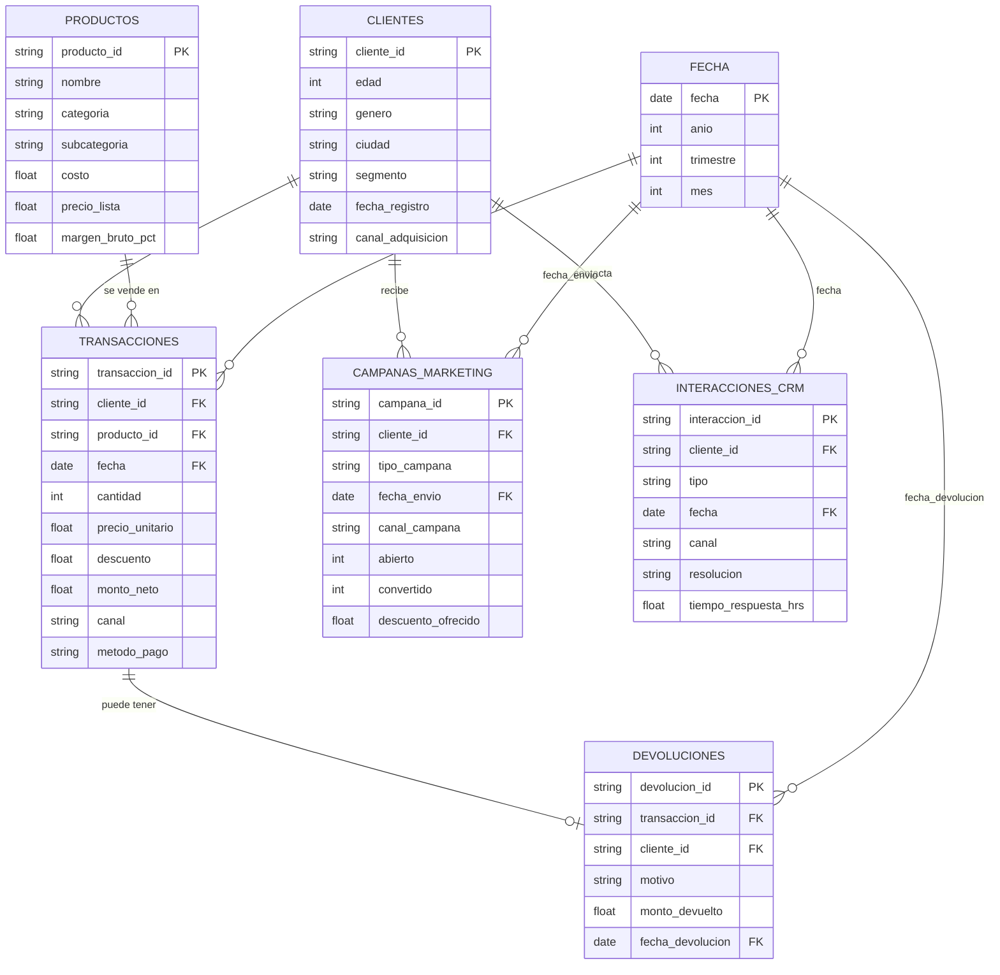

# Cómo se relacionan las tablas

Usamos una **constelación de hechos** (también se llama esquema de galaxia). Es como un esquema estrella, pero con varias tablas de hechos que comparten las mismas tablas de descripción (dimensiones): quién, qué y cuándo.

Hay cuatro tablas de hechos. Cada una registra un tipo de evento y tiene su propio nivel de detalle:

| Hecho | Una fila es… | Se conecta con |
|---|---|---|
| Ventas (`transacciones`) | un producto que un cliente compró en una fecha | cliente, producto, fecha |
| Devoluciones | la devolución de una venta (como mucho una por venta) | la venta que se devuelve, cliente, fecha de devolución |
| Campañas (`campanas_marketing`) | un envío de campaña a un cliente | cliente, fecha de envío |
| Atención al cliente (`interacciones_crm`) | un contacto de un cliente con la empresa | cliente, fecha |

Las dimensiones son **clientes**, **productos** y **fecha**.

- Devoluciones llega al producto a través de la venta.
- Campañas y atención al cliente solo se conectan con el cliente, no con una venta. Por eso los datos no dicen qué campaña generó qué compra, y hay que deducirlo por las fechas (ver `DECISIONES.md`, decisión A1.2).

## Notas

- La tabla de fechas no viene en los archivos. Se arma con las fechas de las demás tablas.
- Devoluciones trae también el código del cliente. Es un dato repetido: siempre coincide con el cliente de la venta (lo comprobamos en el notebook 01). En Power BI, la relación con clientes se hace a través de la venta, para no tener dos caminos.
- Las relaciones "uno a muchos" están comprobadas en el notebook 01, sección 6.
