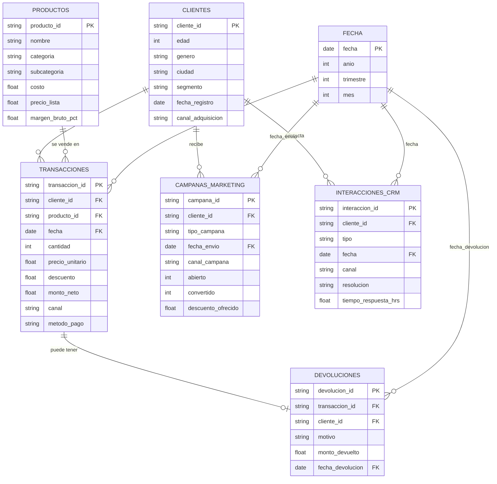

# Cómo se relacionan las tablas

Usamos un esquema estrella: una tabla central con los hechos (las ventas) y, alrededor, las tablas que los describen (quién compró, qué compró y cuándo).

- **Ventas (`transacciones`)** es la tabla central. Cada fila es un producto que un cliente compró en una fecha.
- **Clientes, productos y fechas** son las tablas que describen cada venta.
- **Devoluciones** se conecta con una venta concreta. Cada venta tiene como máximo una devolución.
- **Campañas y atención al cliente** solo se conectan con el cliente, no con una venta. Por eso los datos no dicen qué campaña generó qué compra, y hay que deducirlo por las fechas (ver `DECISIONES.md`, decisión A1.2).

## Notas

- La tabla de fechas no viene en los archivos. Se arma con las fechas de las demás tablas.
- Devoluciones trae también el código del cliente. Es un dato repetido: siempre coincide con el cliente de la venta (lo comprobamos en el notebook 01).
- Las relaciones "uno a muchos" están comprobadas en el notebook 01, sección 6.
