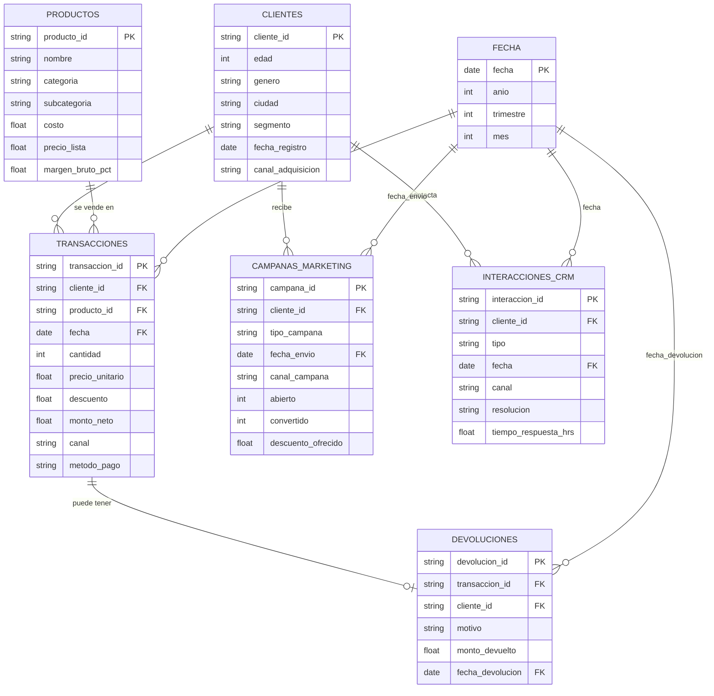

# Modelo relacional (esquema estrella)

`transacciones` es la tabla de hechos principal: una fila es un producto comprado por un cliente en una fecha. Alrededor están las dimensiones `clientes`, `productos` y fecha.

`devoluciones` cuelga de una transacción concreta (cada transacción tiene como mucho una devolución). `campanas_marketing` e `interacciones_crm` son eventos del cliente: solo tienen llave hacia `clientes`, no hacia una compra. Por eso la relación "esta campaña generó esta compra" no está en los datos y hay que inferirla por fechas (ver DECISIONES.md, #2).

Notas:

- `devoluciones.cliente_id` es redundante (siempre coincide con el cliente de la transacción; lo comprobamos en el notebook 01), pero lo dejamos porque viene en el archivo.
- La dimensión fecha no existe como archivo: se genera a partir de las fechas de las demás tablas.
- Cardinalidades comprobadas en `notebooks/01_calidad.ipynb`, sección 6.
